# Oldworld2

This game explores what happens if you combine WoW classes with Diablo random map and item generation, using a Pokemon style combat system. A top-down RPG with a realtime map and turn-based fights.

It is still in early development with all the ballance issues and missing features. The item system is not implemented at all right now.

You explore an endless, procedurally generated overworld
tile by tile; enemies you can see notice you and give chase, and a fight switches to a
separate battle view where your one hero fights them turn by turn with spells and
abilities. Win XP and money, learn abilities, and push outward into harder zones.

The world is 3D (raylib) with a comic look: toon shading and ink outlines, painted battle
backgrounds, our own pixel font, music and sounds.

## Screenshots

<table>
<tr><td width="33%">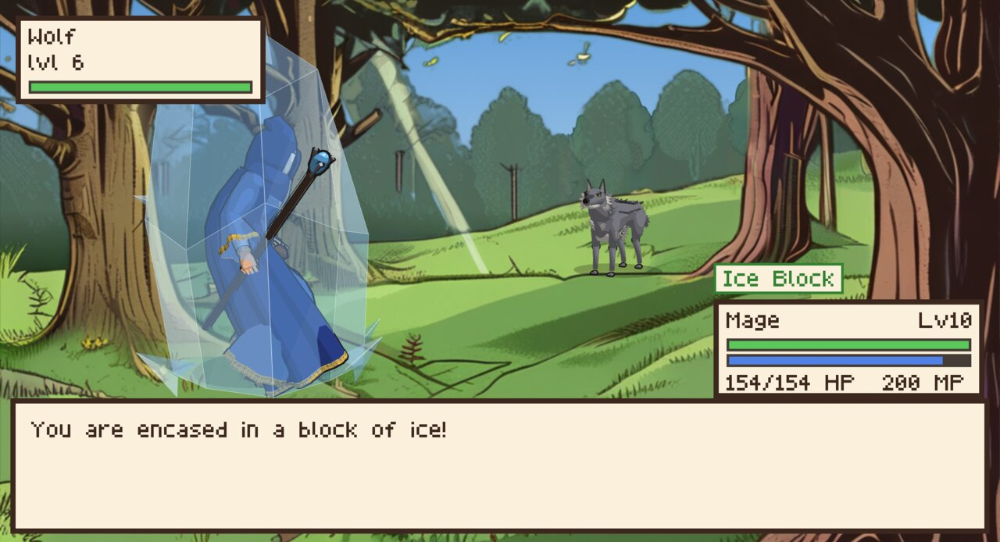 Mage, level 10: Ice Block in the Grassland</td><td width="33%">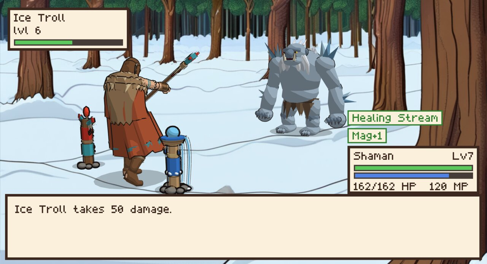 Shaman, level 7: totems in the North</td><td width="33%">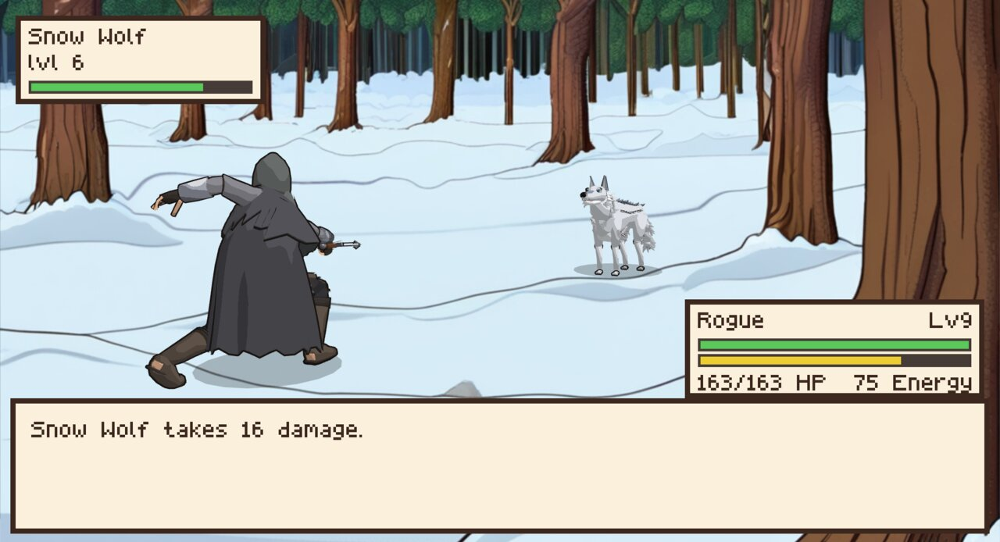 Rogue, level 9: Cheap Shot in the North</td></tr>
<tr><td width="33%">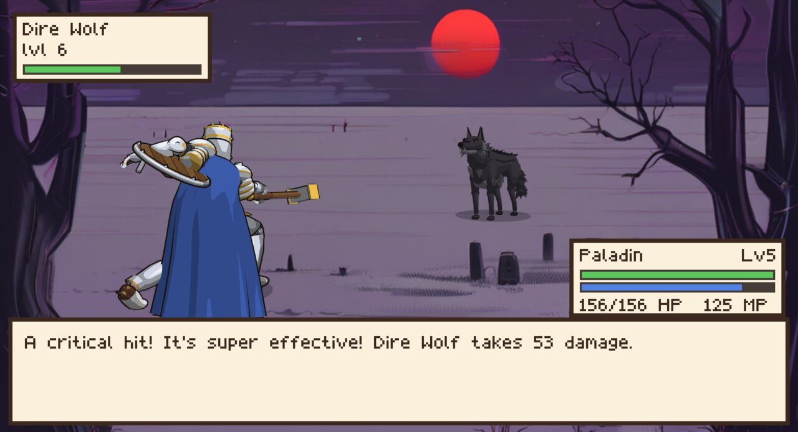 Paladin, level 5: Judgment Hammer in the Unholy lands</td><td width="33%">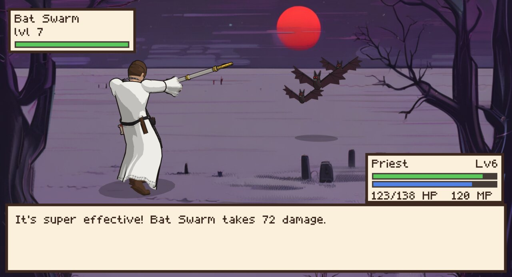 Priest, level 6: Holy Burst against a bat swarm</td><td width="33%">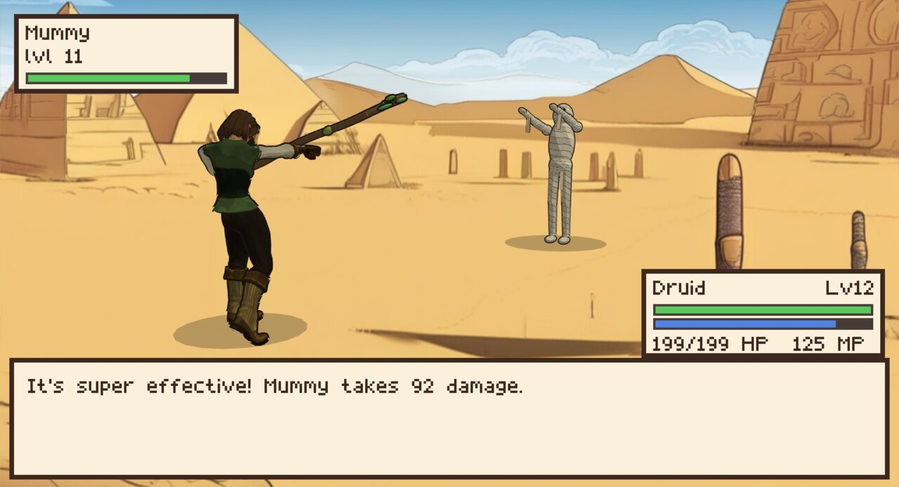 Druid, level 12: Moonbeam against a mummy</td></tr>
<tr><td width="33%">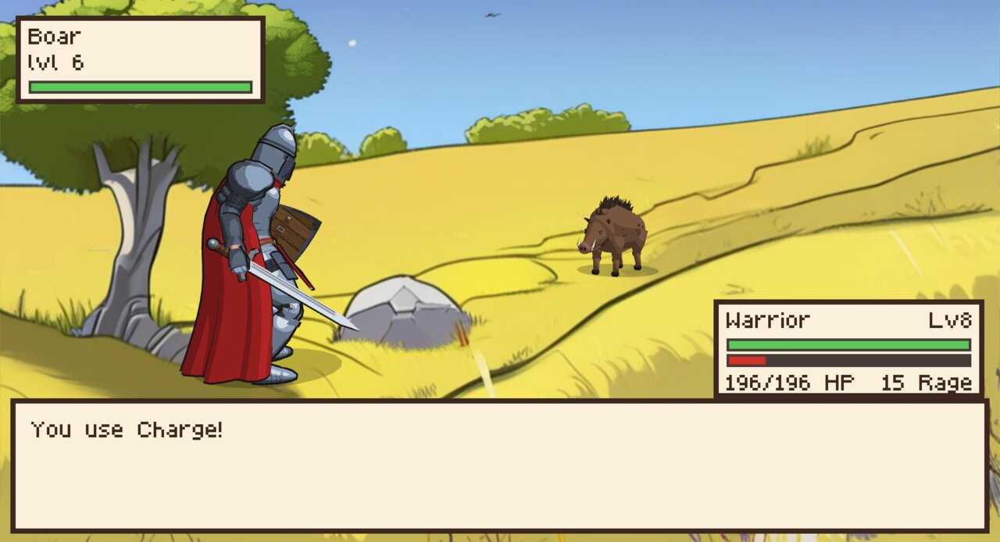 Warrior, level 8: Charge in the Mediterranean</td><td width="33%">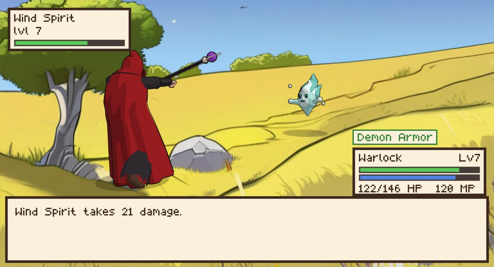 Warlock, level 7: Hellfire Rain against a wind spirit</td><td width="33%">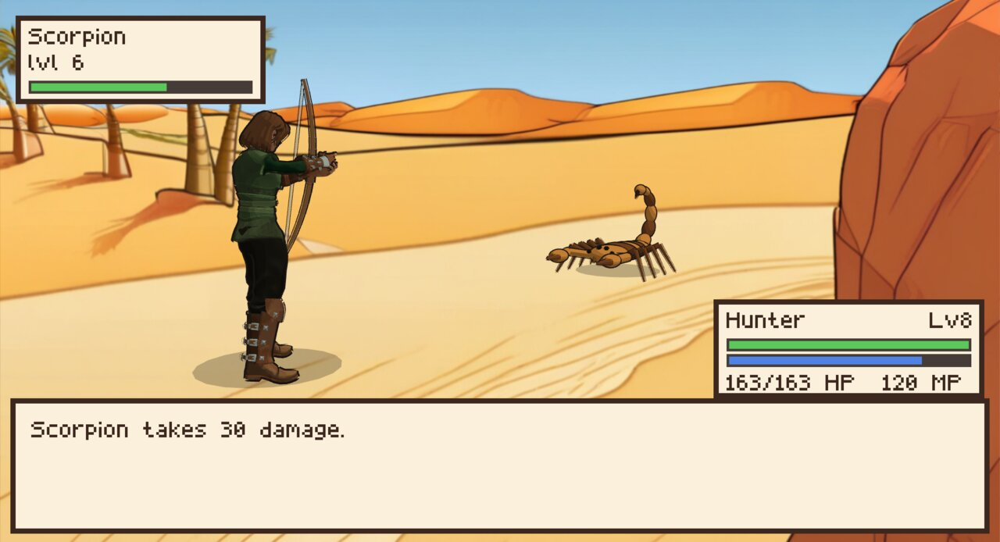 Hunter, level 8: Volley in the desert</td></tr>
<tr><td width="33%">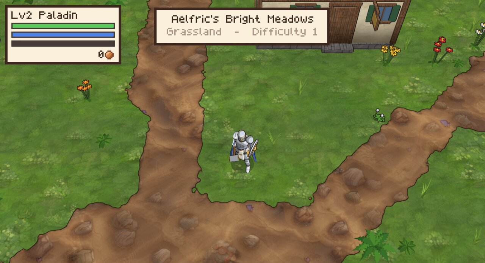 The map: roads near a Grassland settlement</td><td width="33%">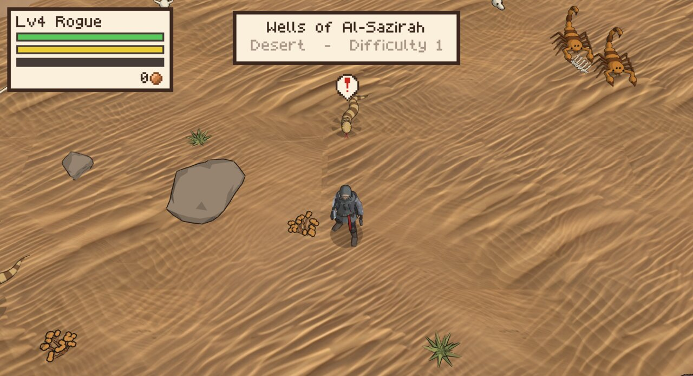 The map: scorpions and a sand snake in the desert</td><td width="33%">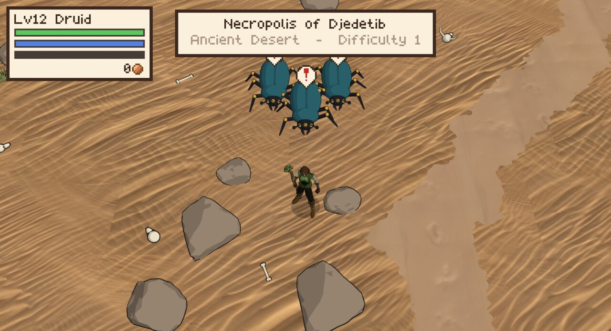 The map: scarabs spot the hero in the Ancient Desert</td></tr>
</table>

## Features

- **Nine classes:** Warrior, Mage, Rogue, Hunter, Warlock, Priest, Paladin, Shaman and
  Druid, each with its own types, stats and abilities learned by level.
- **An endless seeded world** of zones laid out on a grid: Grassland at the center, the
  North, the Mediterranean, the Unholy lands, the Middle Eastern Desert and the Ancient
  (Egyptian) Desert, each with its
  own ground, scenery, settlements, music, names and enemies. Difficulty rises by one per
  zone outward.
- **Settlements** with an inn (rest and checkpoint), roads between zones, shrines along
  them.
- **Battles** with elements and types, physical and magical abilities, status effects,
  stat stages, priority moves and elite enemies.
- **Autosave** to a local database; on defeat you wake up at the last checkpoint.

## Running

Needs Go (see `go.mod`) and a C compiler, since raylib is used through cgo
([raylib-go](https://github.com/gen2brain/raylib-go); on Linux also the X11 and OpenGL
development headers it lists).

The heroes' animations, and the female body and outfits, still come from free
[Quaternius](https://quaternius.com) packs (CC0), which are not in the repository. Download
the "Standard" versions of **Universal Animation Library**, **Universal Base Characters**
and **Modular Character Outfits – Fantasy**, unpack them into `assets/quaternius/`, then run
once:

    python3 tools/models/prepare.py

Then, from the repository root:

    go run ./cmd/game

This opens the title screen: continue the saved game, or set up a new one (class, start
zone, world seed), or watch a demo where the game plays itself with a random class and
zone. Saves go to `~/.local/share/oldworld2/save.db`.

Useful flags for testing: `-new` starts a new game right away, with `-class rogue`,
`-zone north`, `-seed 42`, `-level 6`, `-moves ice_block,blink` (equip these abilities) or `-at X,Y`; `-demo` starts the demo; `-mute` turns the sound off. See
`go run ./cmd/game -h` for all of them.

`tools/screenshots.sh` retakes the screenshots above (needs ImageMagick).

## Controls

| Key | On the map | In battle | In menus |
|-----|------------|-----------|----------|
| WASD / arrow keys | Move | Choose | Move the cursor |
| Shift (hold) | Run | | |
| Space | Interact (inn, shrines) | Confirm | Confirm |
| B | | Back | |
| N | Abilities menu | | Close |
| C | Camp and rest | | |
| Escape | Main menu | | Back |

A gamepad works too: the D-pad moves, A is Space.

## Development

    go test ./...        # unit tests: world generation, battles, saving, movement…
    go vet ./...
    go run ./cmd/mapshot -seed 1 -out map.png           # the generated world as a map image
    go run ./cmd/balance -level 10 -gap 2               # win rates of every class against every enemy
    tools/testrun.sh out.png 120 'right:20,run-down:40'  # scripted run, saves a screenshot

`tools/testrun.sh` opens the game without stealing focus (on a hidden Hyprland workspace),
plays a scripted input and saves a screenshot.

    tools/release/windows.sh    # the Windows release, built on Linux: dist/oldworld2-windows-amd64.exe
    tools/release/linux.sh      # the Linux release: dist/oldworld2-linux-amd64

Each release is one file with the assets inside. It unpacks them on the first start, to
`%LOCALAPPDATA%\oldworld2` on Windows and `~/.cache/oldworld2` on Linux, and saves to
`%AppData%\oldworld2\save.db` or `~/.local/share/oldworld2/save.db`. The Linux build targets
glibc 2.31, so it runs on Ubuntu 20.04, Debian 11 and newer. The builds need the Quaternius
packs and [mise](https://mise.jdx.dev), which installs the Zig C compiler for raylib. If
the game starts loading another pack model, add it to `tools/release/pack_models.txt` (a test
checks this).

Almost all art is made by scripts in this repository:

- **3D models** (bodies, outfits, creatures, weapons, scenery) by Blender scripts in
  `tools/models` (`blender -b --python tools/models/human.py -- …`), writing to
  `assets/generated/`. The heroes and human enemies are modelled after the concept art in
  `art/concept`.
- **Buildings** are built in code from simple shapes (`internal/game/buildings.go`).
- **Textures, battle backgrounds and concept art** are generated locally with
  stable-diffusion.cpp (SDXL Lightning) by `tools/artgen/artgen.py` from the prompt files
  next to it.
- **Music and sound effects** are synthesized by `tools/audio/makeaudio.py`; the pixel font
  is drawn by `tools/font/makefont.py`.

## Project layout

| Path | Contents |
|------|----------|
| `cmd/game` | The game |
| `cmd/mapshot` | Renders part of the world to a PNG, without a window |
| `cmd/balance` | Simulated battles of every class against every enemy, played by the demo's battle planner |
| `internal/game` | Game states: title, map, battles, menus, HUD, the 3D scene, sound |
| `internal/battle` | The battle rules: abilities, types, damage, status effects |
| `internal/character` | Classes, levels and the hero |
| `internal/creature` | Enemy kinds: stats, abilities, behavior |
| `internal/procgen` | World generation: zones, terrain, settlements, roads, enemy spawns, names |
| `internal/world` | The loaded world: chunks, the player, enemies moving and chasing |
| `internal/r3d` | 3D rendering on raylib: toon shading, outlines, characters, the ground |
| `internal/save` | The save file |
| `design/` | The design documents, starting with [game-design.md](design/game-design.md) |
| `tools/` | The asset scripts (models, art, audio, font), the test runner and the release build |
| `art/concept` | Concept art the models follow |
